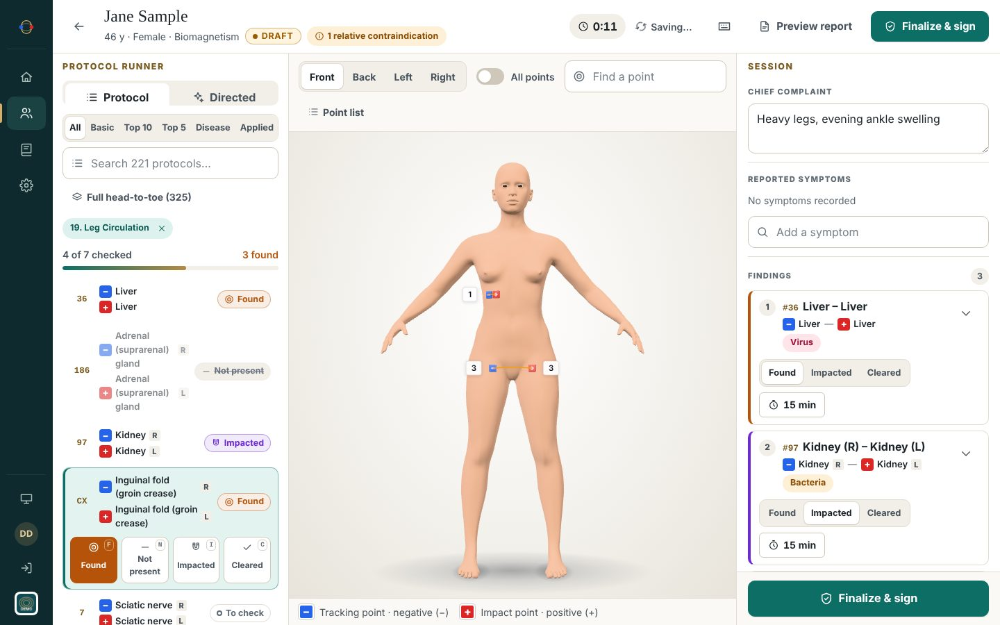
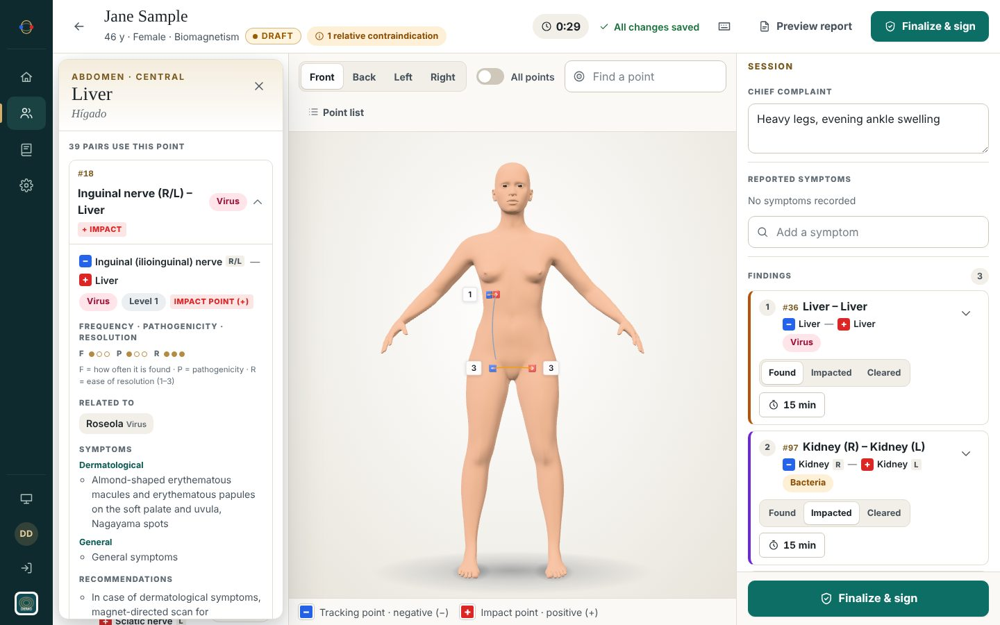
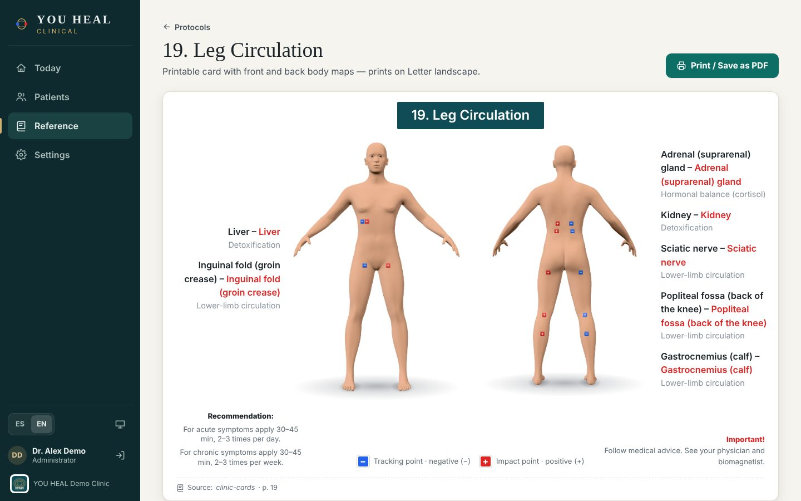
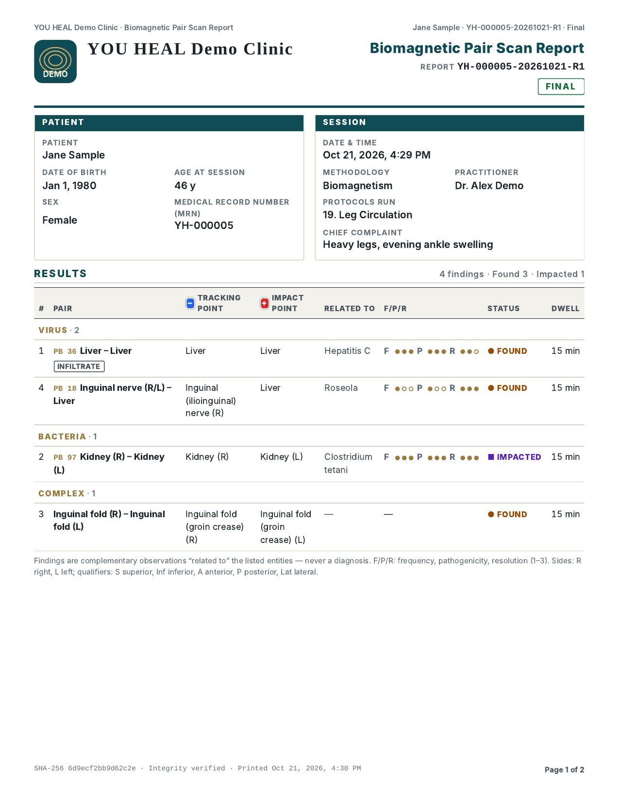
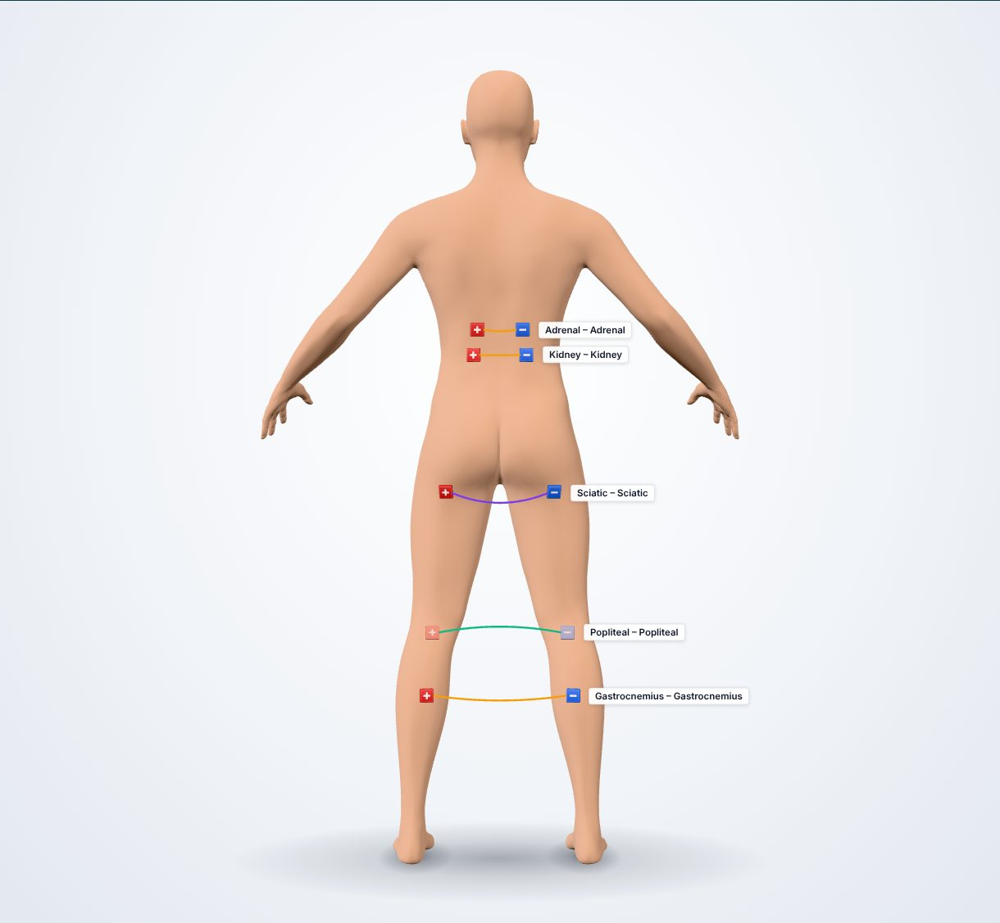
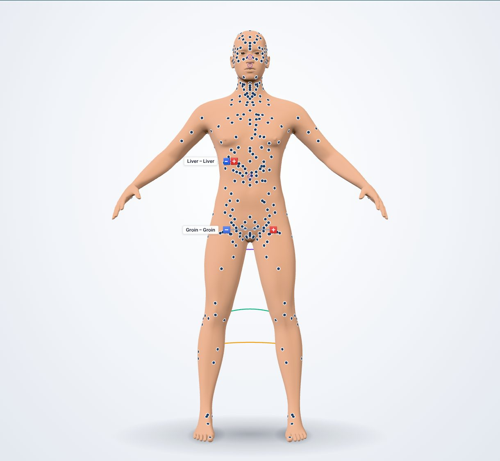
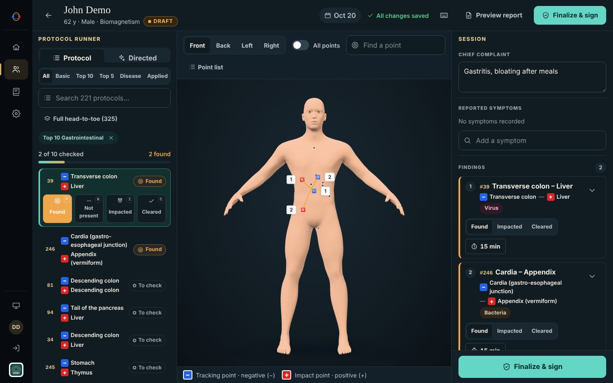

# YOU HEAL

| Project | What it is |
|---|---|
| [`platform/`](platform/README.md) | **YOU HEAL Clinical** — secure, on-premises (SaaS-ready) practitioner platform for Biomagnetic Pair practice: interactive 3D scan map, 325-pair sourced catalog, intake & consent, guided scans, integrity-sealed clinical reports. |
| [`YouHeal-Redesign/`](YouHeal-Redesign/README.md) | Bilingual marketing website redesign prototype for youheal.us. |

## YOU HEAL Clinical — previews

| Click a point → related pairs, symptoms, sources | Clinic protocol card 19, rebuilt live | Clinical report (Letter, print / PDF) |
|---|---|---|
|  |  |  |

| 3D body map — protocol magnets (posterior) | All catalog points on the skin | Dark mode |
|---|---|---|
|  |  |  |

📄 [Sample report (PDF)](platform/docs/previews/ui/sample-report.pdf) · 🖼️ [Full gallery](platform/docs/previews/README.md) · 🔐 [Security](platform/docs/SECURITY.md) · ⚖️ [Regulatory & IP](platform/docs/REGULATORY.md)

**Test it from an iPad or iPhone (no computer needed):** [GitHub Codespaces guide](platform/docs/CODESPACES.md).

**Languages:** English and Spanish — complete UI and clinical catalog as mirrored, database-embedded language packs ([guide](platform/docs/I18N.md)).

All demo data is fictitious. Body imagery is generated by the platform; no third-party artwork.
