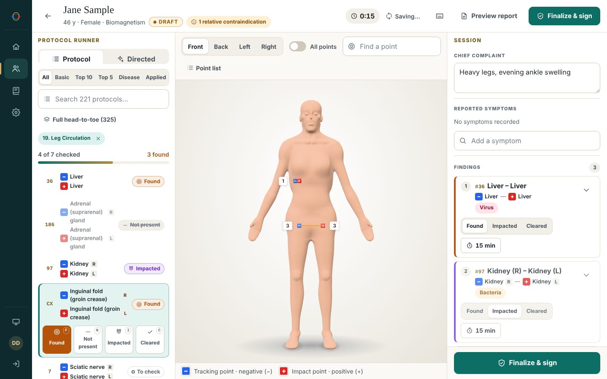
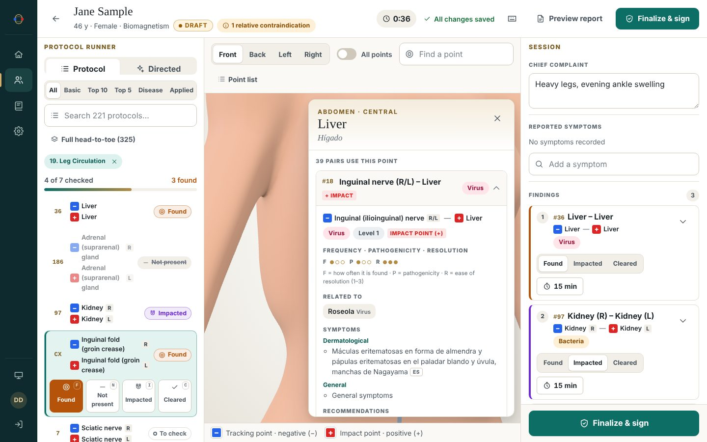
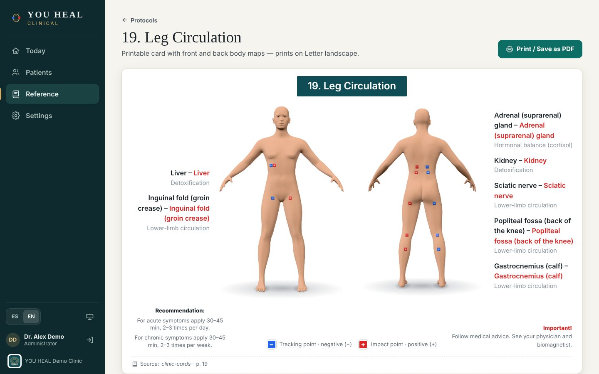
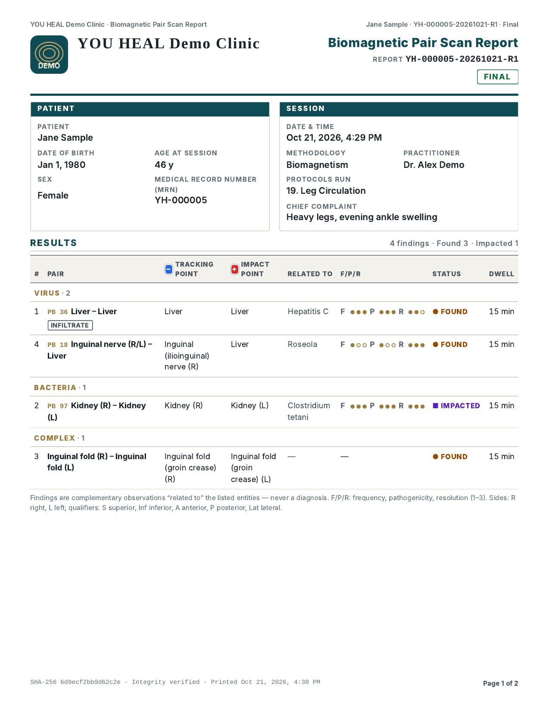

# YOU HEAL Clinical

A secure practitioner platform for **Biomagnetic Pair** (*Par Biomagnético*) practice: patient intake
and consent, guided scan sessions, a sourced reference catalog with an interactive 3D body map, and
integrity-protected session reports. Built for clinics that handle **PHI**: on-premises first (a single
clinic host, offline-capable), SaaS later. English and Spanish UI.

> Findings are **complementary, non-diagnostic observations** — the product says "related to", never
> "diagnosed". See [`docs/REGULATORY.md`](docs/REGULATORY.md).

**Security at a glance**: zero runtime npm dependencies (Node.js ≥ 22.13 standard library only) ·
AES-256-GCM field-level encryption of PHI · scrypt passwords + TOTP MFA (mandatory for admins) ·
hash-chained, append-only audit log · strict CSP, no inline script · TLS by default (plain HTTP refused
on non-loopback interfaces) · encrypted, verified backups · hardened service definitions (systemd sandbox,
read-only non-root container, Windows virtual service account). Details: [`docs/SECURITY.md`](docs/SECURITY.md).

## Previews



| Point drawer | Protocol card 19 | Clinical report |
|---|---|---|
|  |  |  |

More in [`docs/previews/`](docs/previews/README.md).

---

## Quick start

### Development (any OS, Node.js ≥ 22.13)

```sh
npm start              # http://127.0.0.1:8080  (loopback only, no TLS needed; data in ./data)
npm test               # node:test suites
```
Open `http://localhost:8080/#/setup` to create the clinic and first admin (paste the one-time token from
`data/setup-token`; it is written to that file only, never logged in production). On first start the server
generates `data/keys/master.key` — fine for development, never reuse it for real patient data.
No `npm install` is needed: there are no dependencies.

### Docker

```sh
cd deploy/docker
umask 077 && mkdir -p secrets && openssl rand -base64 32 > secrets/master.key
sudo chown 10001:10001 secrets/master.key && sudo chmod 0400 secrets/master.key   # escrow this key!
docker compose up -d --build        # set YH_ALLOWED_HOSTS=<name,ip> if users browse to anything but localhost
docker compose exec -it youheal node --run create-admin    # or: browser setup with the token in /data/setup-token
```
Then browse `https://localhost:8443/` (self-signed certificate; compare the fingerprint printed in
`docker compose logs youheal`). Read-only root FS, all capabilities dropped, port bound to 127.0.0.1.

### Linux / macOS

```sh
./deploy/linux/install.sh --dry-run          # show the plan
./deploy/linux/install.sh --hostname clinic.lan --open-firewall --firewall-source 192.168.1.0/24
```
Installs Node.js if needed (SHA-256 verified), a `youheal` service account, `/opt/youheal`,
`/var/lib/youheal` (0700), master key, TLS certificate, and a hardened systemd / OpenRC / launchd service,
then prints the first-run setup URL.

### Windows (PowerShell 5.1 or 7+)

```powershell
powershell -NoProfile -ExecutionPolicy Bypass -File .\deploy\windows\Install-YouHeal.ps1 -DryRun
powershell -NoProfile -ExecutionPolicy Bypass -File .\deploy\windows\Install-YouHeal.ps1 -HostName clinic.lan -OpenFirewall
```
Self-elevates (UAC), installs Node.js via the verified MSI, registers the `YouHeal` service (WinSW) as
`NT SERVICE\YouHeal`, and restricts `%ProgramData%\YouHeal` to SYSTEM, Administrators and the service.

### Air-gapped

`deploy/offline/build-bundle.sh --os linux --arch x64` (or `build-bundle.ps1 -OS win`) on a connected
machine, then `install.sh --offline-bundle <archive>` / `Install-YouHeal.ps1 -OfflineBundle <zip>` on the
target. Full procedures: [`docs/OPERATIONS.md`](docs/OPERATIONS.md).

---

## Directory map

```
platform/
  package.json            "type":"module", engines node>=22.13, no dependencies
  server/                 HTTP(S) API, auth, RBAC, crypto, audit, backup (index.js, app.js, lib/, routes/, cli/)
    db/migrations/        forward-only SQL migrations
    catalog/              catalog loader (data/catalog/*.json → DB, hash-versioned)
  web/                    no-build ES-module SPA (views, i18n en/es, 3D viewer, vendored three.js)
  data/
    catalog/              generated catalog JSON (committed; every record carries its source)
    sources/              licensed source PDFs (gitignored, never shipped)
    db/ keys/ backups/ tls/   runtime state (gitignored)
  importer/               build-time PDF → JSON pipeline (not shipped)
  tests/                  node:test suites
  deploy/
    common/healthcheck.mjs    zero-dependency health probe (Docker, Linux, Windows)
    docker/               Dockerfile, compose.yaml, entrypoint.sh
    linux/                install / upgrade / backup / restore / uninstall (Linux + macOS), unit files
    windows/              Install/Upgrade/Backup/Restore/Uninstall-YouHeal.ps1, Sign-Scripts.ps1, CLI helper
    offline/              air-gapped bundle builders (.sh / .ps1)
    reverse-proxy/        nginx and Caddy examples
  docs/                   CONTRACT, ADRs, architecture, security, operations, regulatory
```

## npm scripts

| Script | Purpose |
|---|---|
| `npm start` | Run the server (`node --disable-warning=ExperimentalWarning server/index.js`) |
| `npm test` / `npm run test:server` | Test suites |
| `npm run migrate` | Apply database migrations |
| `npm run catalog:load` | Load/refresh the catalog from `data/catalog` (`YH_CATALOG_LICENSES` filters by licence) |
| `npm run create-admin` | Create the first admin or reset one (`-- --email … --reset-mfa`); needs a TTY |
| `npm run rotate-key -- --yes` | Rotate the master key (server stopped; back up first) |
| `npm run backup [-- --out F]` / `-- --verify F` | Encrypted online backup / verify a backup |
| `npm run restore -- <file> --yes` | Restore (server stopped) |

Where npm is absent (Docker image, distro Node packages), use `node --run <script>` with the same names.

## Configuration

Environment variables (`YH_HOST`, `YH_PORT`, `YH_DATA_DIR`, `YH_TLS_CERT`, `YH_TLS_KEY`,
`YH_MASTER_KEY_FILE`, `YH_TRUST_PROXY`, `YH_PUBLIC_ORIGIN`, …) are listed in
[`docs/OPERATIONS.md` §5](docs/OPERATIONS.md#5-configuration-reference). The installers write them to
`/etc/youheal/youheal.env` or `%ProgramData%\YouHeal\config\youheal.env`.

## Documentation

| Document | Contents |
|---|---|
| [`docs/CONTRACT.md`](docs/CONTRACT.md) | Integration contract: architecture decisions, layout, domain model, catalog formats, API, security baseline |
| [`docs/adr/`](docs/adr/) | ADR-001 … ADR-007 (context, decision, consequences, alternatives) |
| [`docs/ARCHITECTURE.md`](docs/ARCHITECTURE.md) | Context/container/component views, data flows, trust boundaries, deployment, SaaS path |
| [`docs/SECURITY.md`](docs/SECURITY.md) | STRIDE threat model, NIST SP 800-53 Rev 5 matrix, HIPAA crosswalk, CSRMC lifecycle, shared responsibility, risk register |
| [`docs/OPERATIONS.md`](docs/OPERATIONS.md) | Runbook: install, setup, TLS, keys, backup/DR, upgrades, logs, incident response, decommissioning |
| [`docs/REGULATORY.md`](docs/REGULATORY.md) | Validity statements in the sources, FDA/FTC, HIPAA applicability, scope of practice, IP licensing |
| [`deploy/reverse-proxy/README.md`](deploy/reverse-proxy/README.md) | Running behind nginx or Caddy |

## Licensing of content

The application code is proprietary (`UNLICENSED`). The reference catalog is derived partly from
third-party works marked "GOIZ™ Intellectual Property © All rights reserved" and from a compilation of
unclear redistribution status; they are flagged `internal-use` and **must not be distributed** outside the
licensed organisation until a licence is in place (ADR-007, REGULATORY.md §5).
