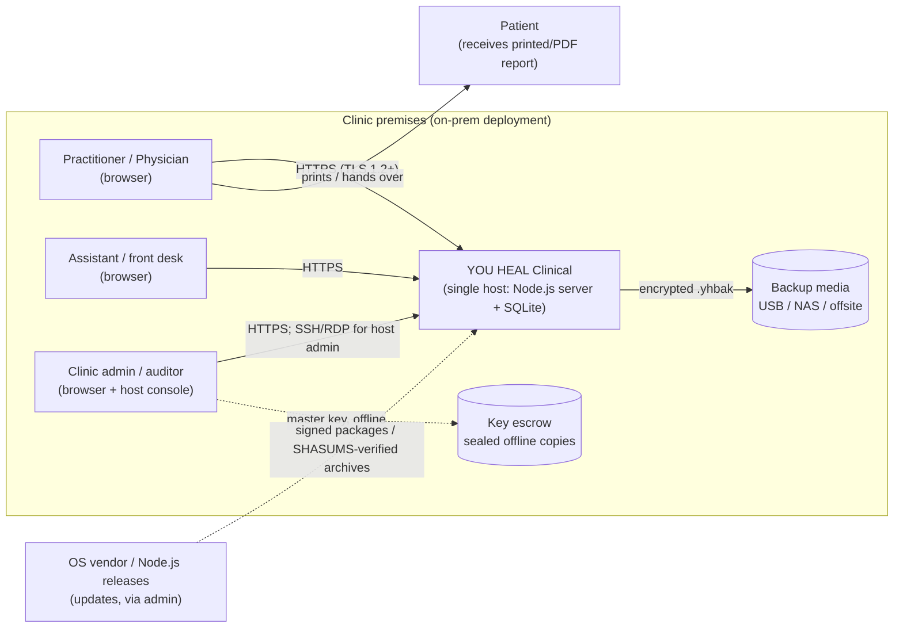
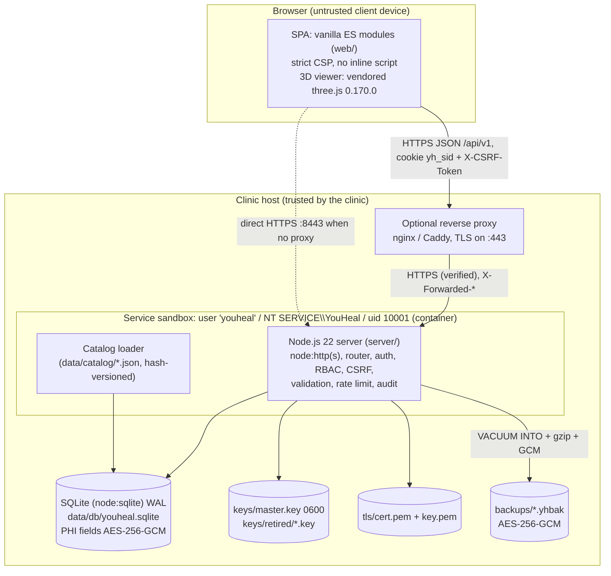
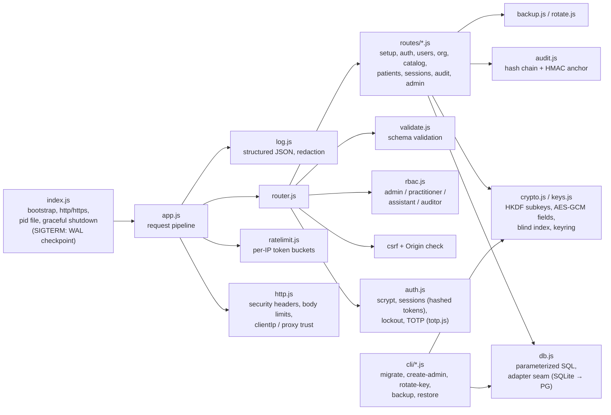
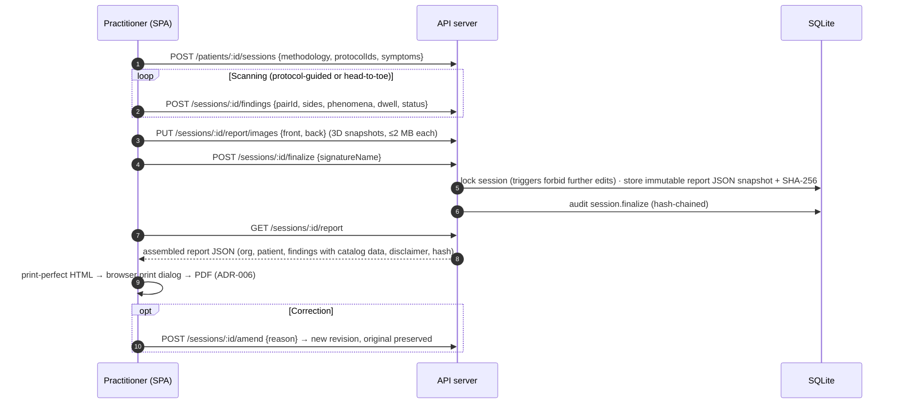
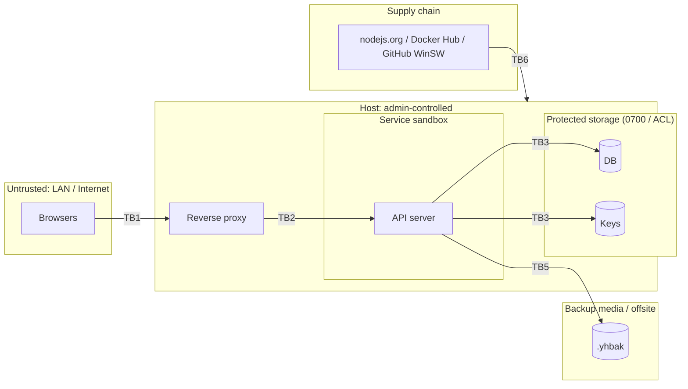
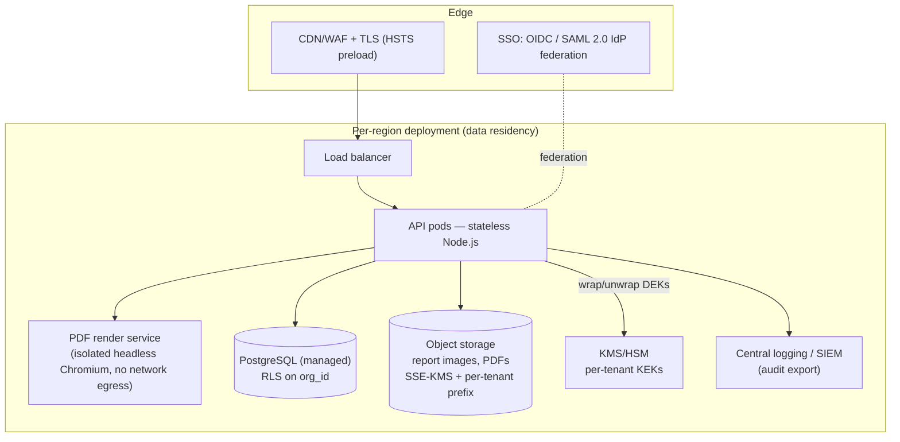

# YOU HEAL Clinical — Architecture

Version 1.0 · October 2026 · Owner: Principal Software Architect / Platform Security
Normative references: [`CONTRACT.md`](CONTRACT.md) (integration contract), [`adr/`](adr/) (ADR-001…007),
[`SECURITY.md`](SECURITY.md), [`OPERATIONS.md`](OPERATIONS.md), [`REGULATORY.md`](REGULATORY.md).

This document describes the system using C4-style views (context → containers → components), the
principal data flows, the trust boundaries used by the threat model, the deployment variants, and the
path from the on-premises product to a multi-tenant SaaS.

---

## 1. Purpose and scope

YOU HEAL Clinical is a practitioner platform for Biomagnetic Pair (*Par Biomagnético*) practice:
patient intake and consent, guided scan sessions (findings = pairs "in resonance"), a reference catalog
with a 3D body map, and a printable, integrity-protected session report. It handles **PHI** (patient
identity, contact data, clinical notes and findings). Users are biomagnetists and physicians; the
technique is complementary and **non-diagnostic** (REGULATORY.md).

Deployment order: **on-premises first** — one clinic, one host, possibly offline — then **SaaS**.

---

## 2. System context (C4 level 1)



The application makes **no outbound network calls** at runtime: no telemetry, no CDN, no licence server.
Internet access is needed only to download the Node.js runtime during installation — and not even then
with an offline bundle.

---

## 3. Containers (C4 level 2)



| Container | Technology | Responsibility | Notes |
|---|---|---|---|
| SPA | ES modules, no build (ADR-004) | UI, i18n (en/es), 3D body map, report print layout | Served by the API process from `web/`; CSP `script-src 'self'` |
| API server | Node.js ≥ 22.13, zero deps (ADR-001) | REST `/api/v1`, sessions, MFA, RBAC, validation, audit, backup | Runs as a dedicated non-root account |
| Database | SQLite via `node:sqlite` (ADR-002) | Tenant data, catalog, audit log | WAL, `foreign_keys`, `secure_delete`; PHI columns encrypted (ADR-003) |
| Key store | File (0600 / ACL) or env / Docker secret | Master key + retired keys | Never in backups, env files or logs |
| Reverse proxy (optional) | nginx / Caddy | CA-issued TLS on 443, HSTS | `YH_TRUST_PROXY=1`, `YH_PUBLIC_ORIGIN` (deploy/reverse-proxy) |

---

## 4. Components of the API server (C4 level 3)



Key component rules (from CONTRACT §7):
* **Authentication**: scrypt (N=2¹⁵, r=8, p=1, 32-byte salt); TOTP MFA (RFC 6238) mandatory for admins,
  10 hashed single-use recovery codes; lockout 5 failures / 15 min per account (HTTP 423) plus per-IP
  token bucket; session tokens 256-bit random, stored as SHA-256, idle 15 min, absolute 12 h, rotated on
  login; cookie `yh_sid` `HttpOnly; Secure; SameSite=Strict`.
* **Authorization**: role checks on every route (least privilege; assistants cannot record findings).
* **Audit**: every auth event, PHI read, create/update/delete, export, finalize; `hash = SHA-256(prev_hash
  ‖ canonical_json(row))`; a keyed HMAC anchor detects tail truncation; DB triggers forbid
  `UPDATE`/`DELETE`; `GET /api/v1/audit/verify` re-walks the chain.
* **Logging**: JSON lines to stderr; known-sensitive keys redacted; no PHI, tokens or passwords.

---

## 5. Data flows

### 5.1 PHI flow (create → store → read → report → backup)

```mermaid
sequenceDiagram
  autonumber
  participant B as Browser (SPA)
  participant S as API server
  participant K as Keyring (HKDF subkeys)
  participant D as SQLite
  participant A as Audit log
  B->>S: POST /api/v1/patients {firstName,lastName,dob,...} + cookie + X-CSRF-Token (TLS)
  S->>S: authn (session hash lookup) · RBAC · CSRF/Origin · schema validation
  S->>K: enc subkey, bidx subkey
  S->>D: INSERT row: AES-256-GCM(field, AAD="patients.<col>:<id>") ; HMAC blind index(lastName, dob)
  S->>A: append {action:"patient.create", target id, field NAMES only} → hash chain
  S-->>B: 201 {id,...}
  B->>S: GET /api/v1/patients/:id
  S->>D: SELECT ciphertexts
  S->>K: decrypt (keyId selects current or retired key)
  S->>A: append {action:"patient.read"}
  S-->>B: decrypted record (Cache-Control: no-store)
  Note over S,D: Backup: VACUUM INTO snapshot → gzip → AES-256-GCM(backup subkey) → .yhbak (key NOT included)
```

PHI exists in plaintext only (a) in the browser of an authenticated user, (b) transiently in server
memory, (c) on paper/PDF reports the practitioner prints. At rest it is ciphertext in the DB, WAL,
snapshots and backups.

### 5.2 Authentication flow

```mermaid
sequenceDiagram
  autonumber
  participant B as Browser
  participant S as API server
  participant D as SQLite
  B->>S: POST /auth/login {email,password}
  S->>S: per-IP token bucket; per-account lockout check (423 if locked)
  S->>D: load user (shadow counters for unknown emails: no account enumeration)
  S->>S: scrypt verify (constant-time compare)
  alt MFA enabled and no/invalid TOTP
    S-->>B: 401 {code:"MFA_REQUIRED"}
    B->>S: POST /auth/login {email,password,totp}
    S->>S: TOTP ±1 step or single-use recovery code
  end
  S->>D: new session: store SHA-256(token), idle/absolute expiry; rotate any prior token
  S->>D: audit auth.login.success / failure
  S-->>B: Set-Cookie yh_sid (HttpOnly; Secure; SameSite=Strict) + {user, csrfToken}
  Note over B,S: Every POST/PATCH/PUT/DELETE carries X-CSRF-Token + matching Origin/Referer
```

### 5.3 Scan → report flow



---

## 6. Trust boundaries

| ID | Boundary | Crossing | Primary controls |
|---|---|---|---|
| **TB1** | Client device ↔ server (network) | HTTPS requests from browsers on the clinic LAN (or Internet via proxy) | TLS 1.2+, HSTS, session cookies, CSRF + Origin, RBAC, validation, rate limits, CSP |
| **TB2** | Reverse proxy ↔ app (optional) | Forwarded HTTP(S) on loopback | Backend bound to 127.0.0.1, `YH_TRUST_PROXY=1` (one hop), verified backend TLS |
| **TB3** | App process ↔ host OS / filesystem | DB, key, TLS key, backups | Dedicated non-root account, 0700 data dir / ACLs, systemd sandbox or read-only container, field encryption |
| **TB4** | Operator ↔ host (administration) | SSH/RDP/console; install, backup, restore, key rotation scripts | OS authentication, sudo/UAC elevation, script logging, signed scripts (Windows AllSigned) |
| **TB5** | Host ↔ backup media / offsite | `.yhbak` files copied to USB/NAS/cloud | AES-256-GCM backups, key not in backup, `.sha256` sidecars, retention |
| **TB6** | Supply chain ↔ build/install | Node.js runtime, WinSW, base image, vendored three.js, catalog content | SHA-256 verification against upstream SHASUMS, pinned hashes, digest-pinnable base image, zero npm deps, bundle checksums, licence gate |
| **TB7** | (SaaS) tenant ↔ tenant | Shared infrastructure | `org_id` + PostgreSQL RLS, per-tenant keys (§8) |



---

## 7. Deployment views

| Variant | Entry point | Process supervision | Isolation | Data | Key |
|---|---|---|---|---|---|
| **Docker** | `deploy/docker/compose.yaml` | Docker restart policy, tini PID 1, HEALTHCHECK | read-only rootfs, `cap_drop: ALL`, `no-new-privileges`, uid 10001, pids/mem limits, port on 127.0.0.1 | named volume `/data` | Docker secret file → `YH_MASTER_KEY_FILE` |
| **Linux** | `deploy/linux/install.sh` | systemd (hardened unit) or OpenRC | `ProtectSystem=strict`, `ReadWritePaths=<data>`, empty capability set, syscall filter, `PrivateTmp/Devices`, `UMask=0077` | `/var/lib/youheal` 0700 | `/var/lib/youheal/keys/master.key` 0600 |
| **macOS** | `deploy/linux/install.sh` | launchd daemon | dedicated hidden user, `Umask 0077` | `/usr/local/var/youheal` 0700 | same, 0600 |
| **Windows** | `deploy/windows/Install-YouHeal.ps1` | Windows service via WinSW | virtual account `NT SERVICE\YouHeal`, ACLs SYSTEM/Administrators/service only | `%ProgramData%\YouHeal` | `…\keys\master.key` (ACL) |
| **Air-gapped** | `deploy/offline/build-bundle.*` → any of the above with `--offline-bundle` | as above | as above | as above | as above |

**Release layout (Linux/macOS/Windows)**: `<prefix>/releases/<version>-<UTC timestamp>/` with
`<prefix>/current` → active release (symlink; junction on Windows). Code is root/Administrators-owned
and not writable by the service. Upgrades stage a new release beside the old one, so rollback is a link
switch plus restoring the pre-upgrade DB snapshot (migrations are forward-only).

### 7.1 Windows service host: WinSW (decision)

Node.js cannot speak the Windows Service Control Manager protocol, so a host wrapper is required. Two
options were evaluated:

| Criterion | **WinSW 2.12.0 (chosen)** | Scheduled Task at startup |
|---|---|---|
| Real service (SCM states, `Get-Service`, monitoring agents, dependencies) | Yes | No (task, invisible to service monitoring) |
| Run as virtual service account `NT SERVICE\YouHeal` | Yes (`sc.exe config obj=`) — unique SID, no password, least privilege | **No** — Task Scheduler supports SYSTEM, LOCAL SERVICE, NETWORK SERVICE, gMSA or a password-bearing user only |
| Graceful stop | Sends Ctrl+C → Node `SIGINT` handler → WAL checkpoint | Task "End" terminates the process |
| Restart on failure / backoff | `onfailure` + SCM recovery actions | Limited retry settings |
| Log capture/rotation | Built-in roll-by-size | None (must redirect manually) |
| Third-party code | One MIT-licensed binary, **SHA-256 pinned** in `YouHeal.Common.psm1`, also shippable in the offline bundle | None |

WinSW wins on least privilege (virtual account), observability and graceful shutdown; its supply-chain
cost is bounded by hash pinning (TB6). The .NET Framework 4.6.1 build (`WinSW.NET461.exe`, 641 KB) is
used because it runs on x64, x86 and ARM64 Windows 10 / Server 2016+ without a separate .NET runtime.

### 7.2 Why the Docker entrypoint runs migrations

The container is the unit of upgrade: a new image starts, migrates forward and serves. The entrypoint
fails closed (no key → no start), generates a self-signed certificate only when none is mounted (so the
app never serves plain HTTP on a non-loopback interface — the server refuses that by design), and then
`exec`s Node under tini for correct signal handling.

---

## 8. On-premises → SaaS migration path

The on-prem design already contains the seams the SaaS needs; the migration is a **deployment and
adapter change, not a rewrite** (ADR-002).



| Concern | On-prem today | SaaS target | Migration mechanism |
|---|---|---|---|
| Database | SQLite file | Managed **PostgreSQL** | Second implementation of `server/lib/db.js`; migrations translated (SQLite-specific statements already isolated); `pg_dump` replaces `VACUUM INTO` in `lib/backup.js` |
| Tenant isolation | Single `org_id` | Many orgs per cluster | `org_id` already on every tenant table → **PostgreSQL row-level security** policies `USING (org_id = current_setting('app.org_id'))` set per transaction; app-level checks remain (defense in depth); optional schema-per-tenant or DB-per-tenant for large customers |
| Encryption keys | One master key file per clinic | **KMS envelope encryption**: per-tenant data-encryption key (DEK) wrapped by a per-tenant KEK in KMS/HSM; DEK cached in memory with TTL | Ciphertext format already carries `keyId`; rotation path (`rotate.js`) re-encrypts; tenant offboarding = KEK destruction (crypto-erase per tenant) |
| Blobs (report images) | SQLite rows | **Object storage** (S3-compatible) with SSE-KMS, per-tenant prefixes, signed short-lived URLs, versioning + object lock for finalized reports | Storage interface behind the report routes |
| PDF | Browser print (ADR-006) | Server-side **headless-Chromium PDF service**: separate container, seccomp, no egress, renders the same HTML; output hashed and stored | Optional — browser path remains |
| Identity | Local accounts + TOTP | **SSO via OIDC and SAML 2.0** (Entra ID, Google Workspace, Okta), SCIM provisioning, enforced MFA at IdP; local accounts for break-glass | New authn provider behind `auth.js`; sessions and RBAC unchanged |
| Catalog licensing | `internal-use` allowed internally | Only `licensed`, `original`, `public-domain` | `YH_CATALOG_LICENSES` filter (ADR-007) + signed licence agreement (REGULATORY.md §5) |
| Hosting | Clinic host | **Regional hosting** (e.g. US region for US clinics; EU/LatAm regions for local residency laws); per-region keys | Region chosen at tenant creation; no cross-region replication of PHI without contract basis |
| Audit | Local hash chain | Hash chain per tenant + streaming export to SIEM/WORM storage | `audit.js` unchanged; export job |
| Compliance | Clinic is the regulated entity | Vendor is a HIPAA **Business Associate**: signed **BAA** with every covered-entity customer (45 CFR §164.502(e), §164.504(e)), and BAAs with sub-processors (cloud, email, logging); SOC 2 Type II / HITRUST as market expectation | Contract + controls; SECURITY.md control matrix becomes the SSP baseline |

**Pre-conditions for SaaS launch**: content licence from the GOIZ rights holder (or catalog restricted to
original/licensed content), BAA template reviewed by counsel, KMS integration, PostgreSQL adapter with
RLS tests that prove cross-tenant reads fail, penetration test, incident-response retainer, and an
updated threat model for TB7.
