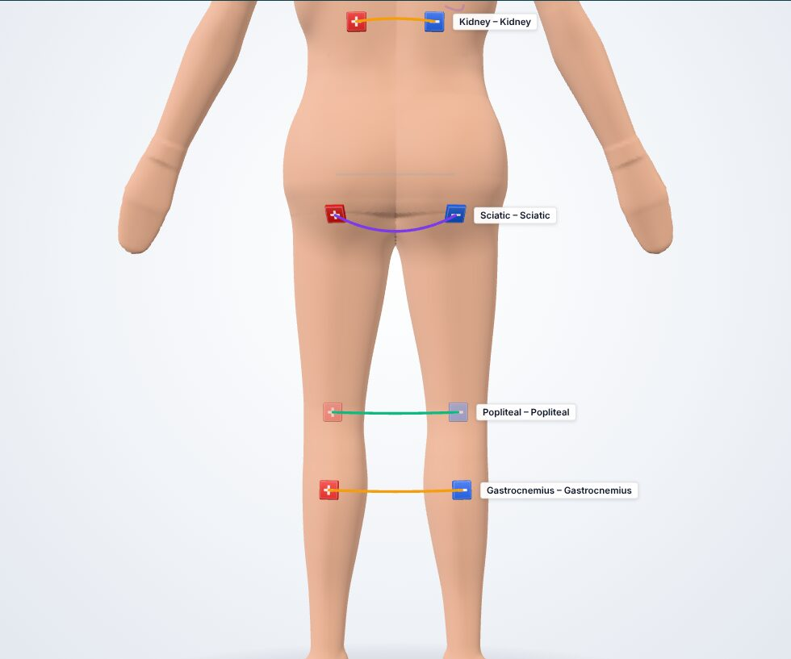
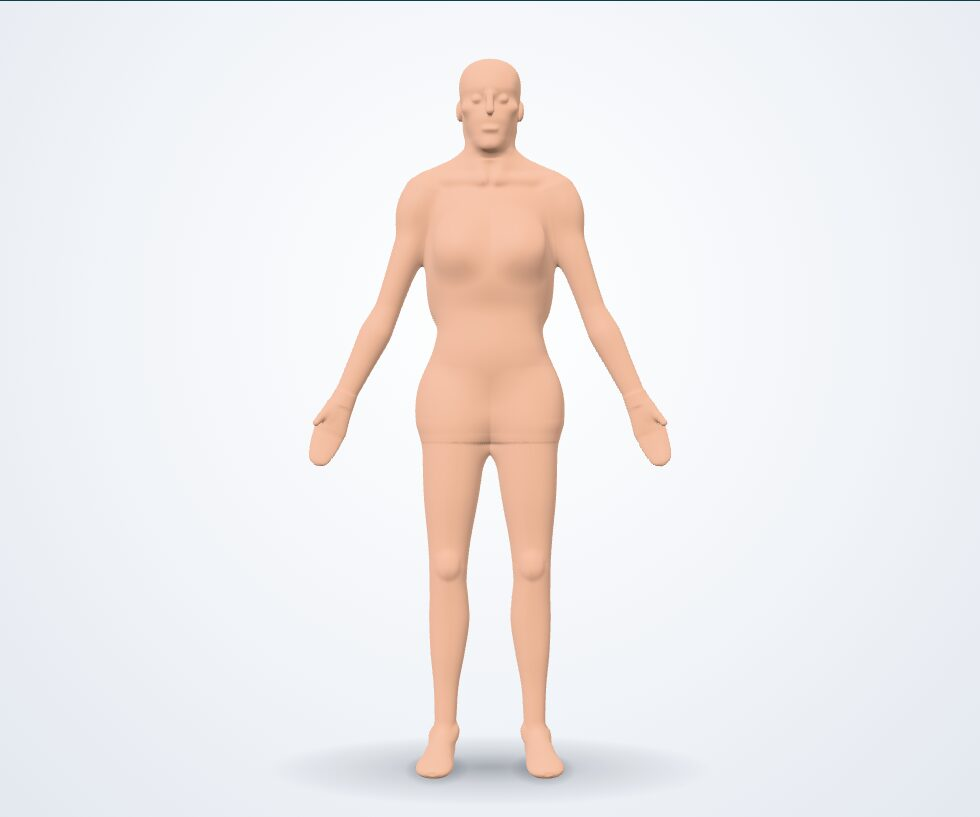
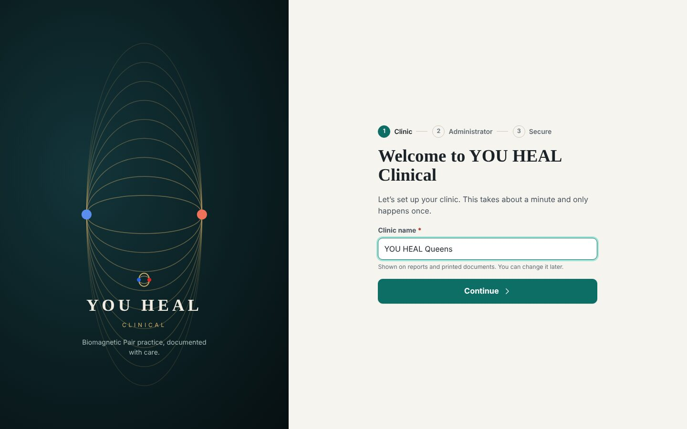

# YOU HEAL Clinical — Visual Previews

> **3D body map: final.** **Practitioner UI: in progress** — the scan workspace, point drawer,
> symptom-directed scan, catalog, protocol cards, printed report (plus a sample PDF), tablet, dark mode and
> Spanish land in `ui/` after the integration pass, and this page will be updated.

All figures are generated by the platform (signed-distance-field mannequin rendered with three.js); no
third-party or copyrighted imagery. Polarity follows the source guides: **negative (−, blue)** on the
tracking point, **positive (+, red)** on the impact point.

## 3D body map — interactive scan infrastructure

| Anterior | Posterior |
|---|---|
|  |  |

| Clinic card *"19. Circulación de Piernas"* rebuilt on the model | All 287 catalog points snapped to the skin |
|---|---|
|  |  |

| Magnet tiles (− / +) with field-line arc per pair | Lateral |
|---|---|
|  |  |

| Female proportion variant | Facial / cranial points |
|---|---|
|  |  |

## 2D fallback (no WebGL) — same API, same points and magnets

## Practitioner UI (in progress)

