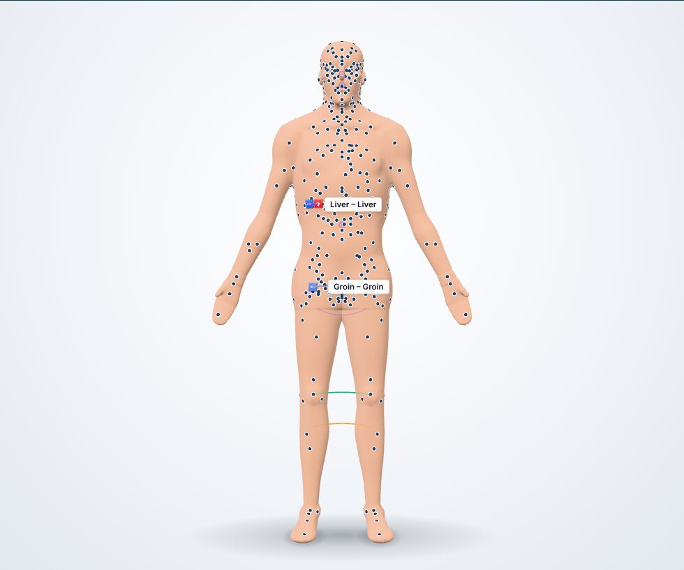
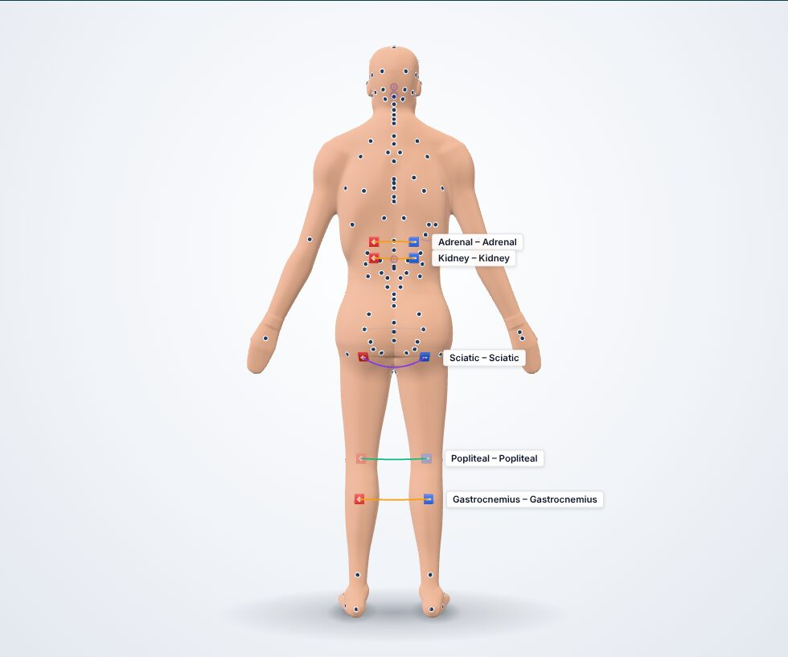
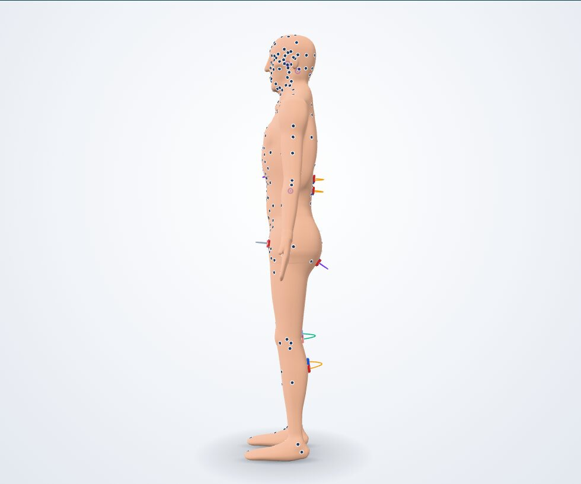
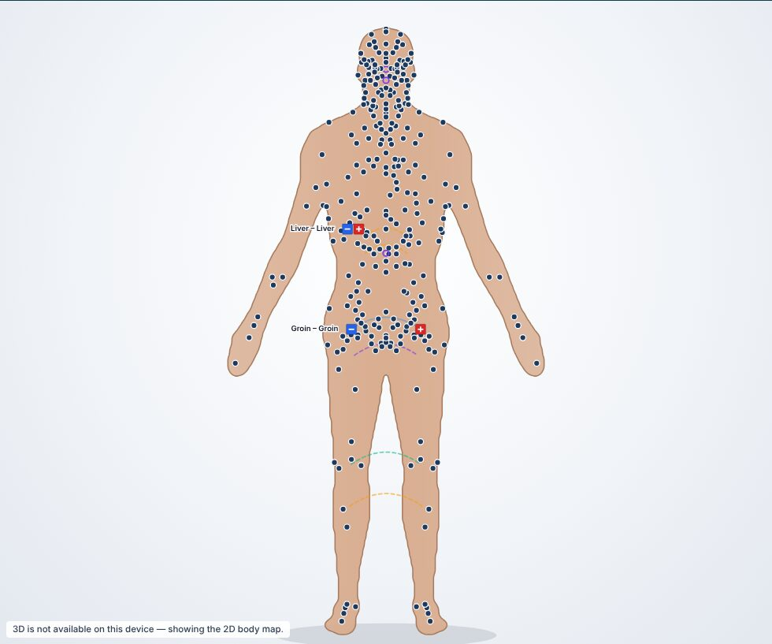

# YOU HEAL Clinical — Visual Previews

> **Status: work-in-progress build (2026-10-21).** These are captured from the live build while the 3D
> anatomy and practitioner UI workstreams are still being finished. The final set — scan workspace, point
> drawer, symptom-directed scan, catalog, protocol cards, the printed report (plus a sample PDF), tablet,
> dark mode and Spanish — will land in `ui/` and `3d/` after the integration pass, and this page will be updated.

All figures are procedurally generated by the platform (no third-party or copyrighted imagery). Polarity
follows the source guides: **negative (−, blue)** on the tracking point, **positive (+, red)** on the impact point.

## First-run setup

## 3D body map — interactive scan infrastructure

| Anterior — all 286 catalog points snapped to the skin | Posterior — protocol *"19. Circulación de Piernas"* |
|---|---|
|  |  |

| Magnet tiles (− / +) with field-line arcs per pair | Lateral view |
|---|---|
|  |  |

| Female proportion variant | Facial / cranial points |
|---|---|
|  |  |

## 2D fallback (no WebGL) — same API, same points and magnets

